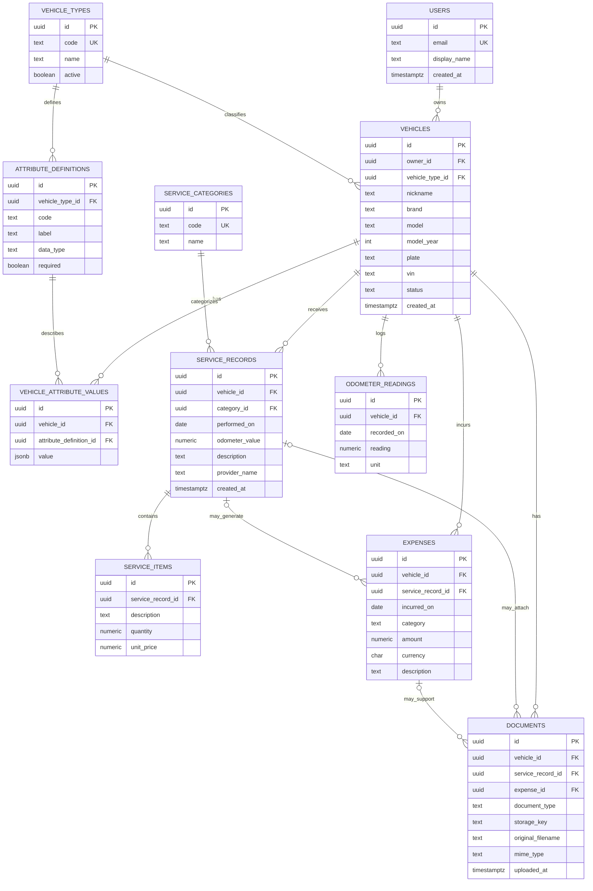

# Modelo entidad-relación — TrackVikol

Versión 0.1 · 2026-11-11 · Estado: propuesta, no implementada.

## Diagrama ER (Mermaid)

## Cardinalidades y decisiones
- Un usuario puede registrar muchos vehículos; cada vehículo tiene un propietario en la versión inicial.
- Un tipo de vehículo (carro, moto, patineta, bicicleta) define atributos propios sin crear una tabla nueva por tipo.
- Cada mantenimiento puede tener varios ítems, gastos asociados y soportes.
- Los gastos pueden existir sin mantenimiento (combustible, peajes, impuestos).
- Un documento pertenece a un vehículo y puede vincularse opcionalmente a un mantenimiento o gasto.
- Lecturas de kilometraje/distancia permiten trazabilidad; la unidad puede ser km o mi.
- La propiedad compartida, transferencias, recordatorios y proveedores normalizados quedan como evolución futura.

## Reglas pendientes de validar
Definir autenticación, permisos por usuario, catálogos de gastos, moneda predeterminada, tipos de documentos, vencimientos, privacidad de placas/VIN y política de archivos.
